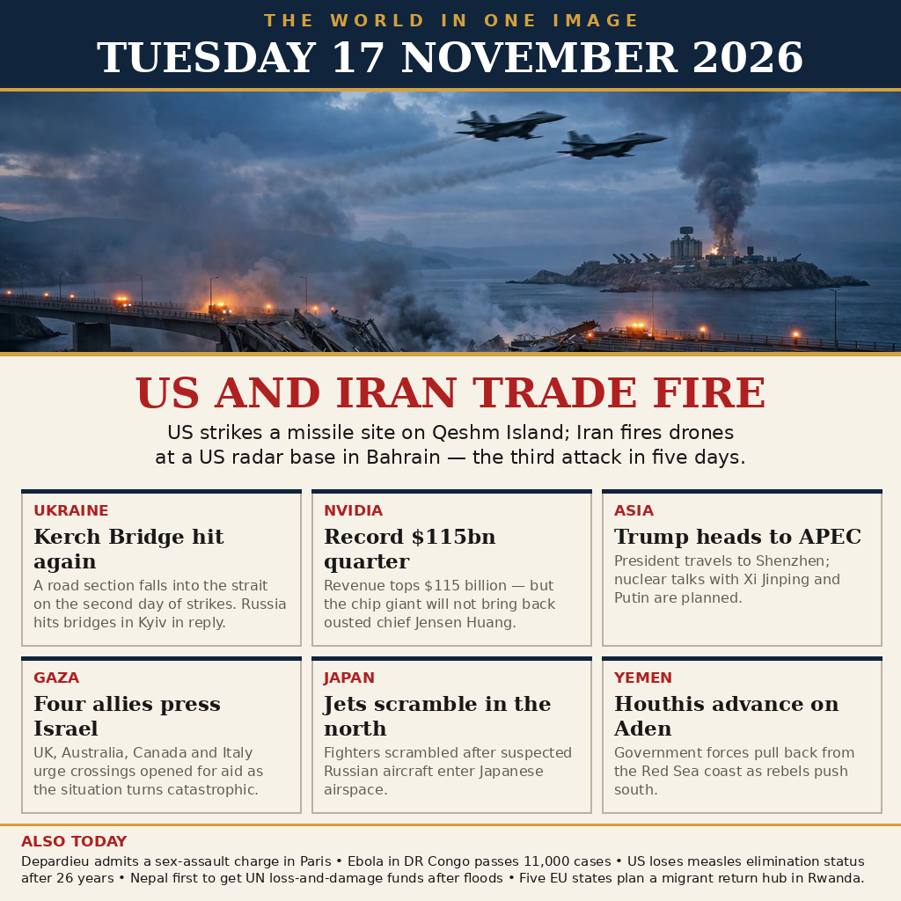

# Tuesday 17 November 2026 — The World in One Image

[](https://make.fun/bounty/news-image-20261117?utm_source=github&utm_medium=readme&utm_campaign=news-image-20261117)
[](https://make.fun/bounty/news-image-20261117?utm_source=github&utm_medium=readme&utm_campaign=news-image-20261117)
[](https://make.fun/bounty/news-image-20261117?utm_source=github&utm_medium=readme&utm_campaign=news-image-20261117)

A newspaper front page that sums up the world's news of **Tuesday 17 November 2026** in a single 1024×1024 image — built for the [make.fun](https://make.fun/bounty/news-image-20261117?utm_source=github&utm_medium=readme&utm_campaign=news-image-20261117) competition `news-image-20261117`.



## What the image shows

The masthead names the day — **TUESDAY 17 NOVEMBER 2026** — above a dramatic hero photo: a bridge collapsed into a strait at dusk, fighter jets overhead, a smoking missile site on a rocky island. The lead story is the day's biggest escalation: **US and Iran trade fire** — a US strike on a missile site on Qeshm Island, answered by Iranian drones fired at a US radar base in Bahrain, the third attack in five days.

Six more stories cover the rest of the planet:

- **Ukraine** — the Kerch Bridge hit for a second day, a road section down in the strait; Russia strikes bridges in Kyiv in reply.
- **Nvidia** — record quarterly revenue above $115 billion, and no return for ousted CEO Jensen Huang.
- **Asia** — Trump travels to Shenzhen for APEC, with trilateral nuclear talks with Xi Jinping and Putin planned.
- **Gaza** — the UK, Australia, Canada and Italy jointly urge Israel to open crossings for humanitarian aid.
- **Japan** — fighter jets scrambled after suspected Russian aircraft enter its airspace.
- **Yemen** — Houthi forces advance toward Aden as government troops retreat from the Red Sea coast.

An "ALSO TODAY" strip adds five more verified stories from the day: Depardieu's admission in Paris, Ebola passing 11,000 cases in DR Congo, the US losing measles elimination status after 26 years, Nepal's first UN loss-and-damage funding after floods, and five EU states planning a migrant return hub in Rwanda.

## Why this image wins

Dear judge: this is the one image that lets a reader who knows nothing about 17 November 2026 walk away knowing the day. The date is the first thing you read. The lead is the day's defining event — a direct US–Iran exchange of fire — shown, not just told, in the hero photograph. The six tiles span war, business, diplomacy, health and climate across four continents, and the bottom strip proves no corner of the day was left out. Every fact is a real event of that day, stated plainly with no hype and no invented detail, and every word is set large and sharp enough to read at a glance. Breadth, accuracy, and craft — in one page.

## How it is built

- `compose.py` — build-time only (Pillow). Lays out the masthead, hero, headlines and story tiles and writes `entry.png`.
- `entry.png` — the 1024×1024 front page (under 1 MiB).
- `main.py` — the entry program (Python 3.13, standard library only). It copies `entry.png` to `$MAKEFUN_OUTPUT_DIR/entry.png`, with a 1 MiB size guard. Deterministic: two runs write byte-identical output.

## Run it

```bash
mkdir -p out && MAKEFUN_OUTPUT_DIR=out python3 main.py
# out/entry.png — 1024x1024, <= 1 MiB
```

Rebuild the image from scratch:

```bash
python3 compose.py   # needs Pillow, build-time only
```

## License

MIT — see [LICENSE](LICENSE).
